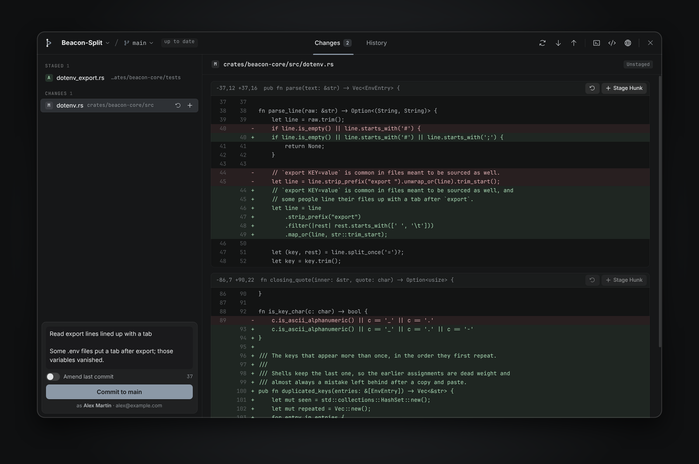
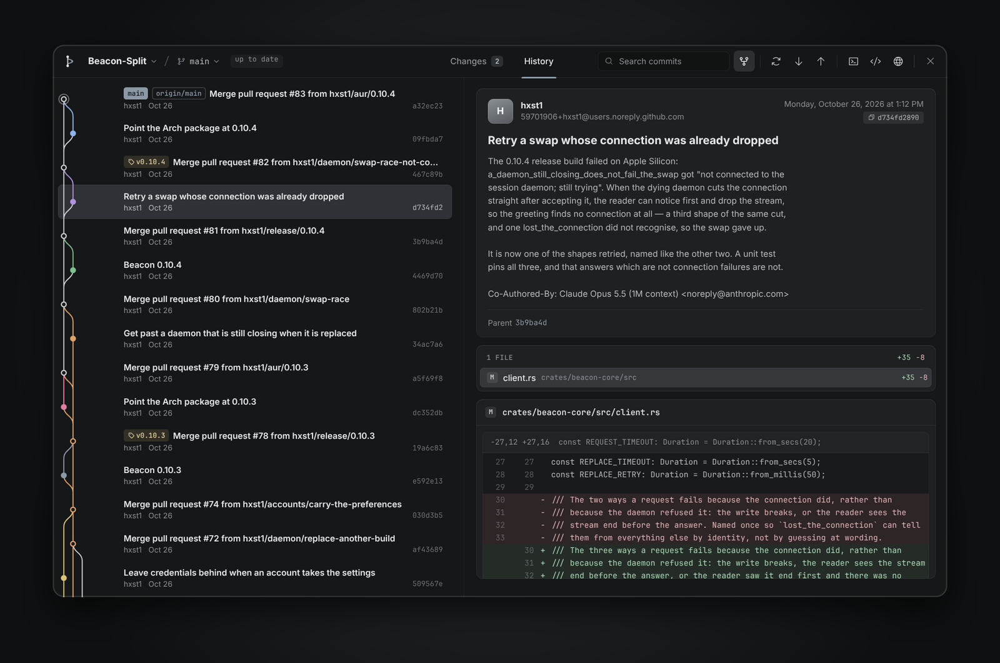
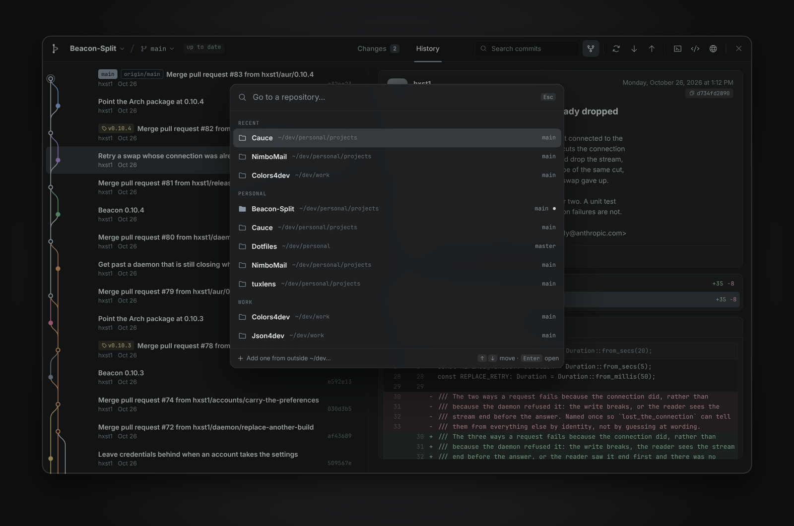

<div align="center">


# Cauce

**A beautiful, minimal Git client for Linux.**

Stage single hunks, read a clean branch graph and jump between repositories with <kbd>Ctrl</kbd>+<kbd>P</kbd> — in a dark, glassy interface that stays out of your way.

[](https://github.com/hxst1/Cauce/releases/latest)
[](LICENSE)
[](#install)
[](#install)

[Download](https://github.com/hxst1/Cauce/releases/latest) · [Features](#features) · [Install](#install) · [Shortcuts](#keyboard-shortcuts)

<br>



</div>

## Why Cauce?

Most Git GUIs on Linux are either heavy, cluttered or look out of place on a modern desktop. Cauce (Spanish for *riverbed*, where streams split and merge) does the everyday work — review, stage, commit, branch, sync — and nothing else, with a calm interface built for keyboards.

It drives **the `git` already on your system**, so everything you've configured keeps working: your `~/.gitconfig`, per-folder identities with `includeIf`, SSH host aliases, hooks, signing and credential helpers. There's no account, no cloud and no telemetry.

## Features

- **Every repository in `~/dev`, one keystroke away.** <kbd>Ctrl</kbd>+<kbd>P</kbd> opens a fuzzy palette with your recent repos on top and the rest grouped by folder (personal, work, company…), each with its branch, ahead/behind counts and a dot when it has changes. Repos elsewhere can be added from there.
- **Stage exactly what you mean.** See the diff of every file, then stage, unstage or discard whole files or **individual hunks**. Discarded new files go to the trash, not into oblivion.
- **Commit with confidence.** Write the message with a first-line counter, press <kbd>Ctrl</kbd>+<kbd>Enter</kbd> to commit, and amend the last commit when you need to. The git identity that will author the commit is shown right under the button, so work never goes out with your personal email again.
- **A history you can actually read.** A colored branch graph with tags and remote branches, search by message or author, and the full detail of every commit: message, parents, changed files with line counts and their diffs. Respects `.mailmap`.
- **Branches without ceremony.** <kbd>Ctrl</kbd>+<kbd>B</kbd> to switch (remote branches are tracked automatically), create a branch from HEAD, another branch or any commit, merge and delete — with a warning before you lose unmerged commits.
- **Fetch, pull and push.** A new branch is published with its upstream on the first push. SSH and HTTPS passwords are asked in a native dialog (`ksshaskpass` or any `ssh-askpass`).
- **Always up to date.** Commits, checkouts and staging done from the terminal or your editor show up instantly.
- **Open anywhere.** Jump to the repository in your terminal, in Zed, or on GitHub/GitLab in your browser.
- **English and Spanish**, following your system language.

<table>
  <tr>
    <td width="50%"></td>
    <td width="50%"></td>
  </tr>
  <tr>
    <td align="center"><sub>History with branch graph and commit detail</sub></td>
    <td align="center"><sub>Repository palette (<kbd>Ctrl</kbd>+<kbd>P</kbd>)</sub></td>
  </tr>
</table>

## Install

Grab the latest build from the [releases page](https://github.com/hxst1/Cauce/releases/latest):

| Package | For |
|---|---|
| **`cauce_<version>_amd64.deb`** | Debian, Ubuntu, Linux Mint, Pop!_OS… — `sudo apt install ./cauce_*_amd64.deb` |
| **`Cauce-<version>-x86_64.AppImage`** | Any distribution — `chmod +x` it and run it (needs FUSE 2: `fuse2` on Arch, `libfuse2t64` on Ubuntu 24.04, `fuse-libs` on Fedora) |
| **`Cauce-<version>-x64.tar.gz`** | Any distribution — unpack it and run `cauce` |

You only need **git** installed. Cauce works on Wayland and X11, and looks especially at home on tiling compositors like Hyprland and Sway with blur enabled.

### Build from source

You need Node.js 24, [pnpm](https://pnpm.io) and git.

```sh
git clone https://github.com/hxst1/Cauce.git
cd Cauce
pnpm install
pnpm instalar        # builds and installs into ~/.local (no root): app, launcher and desktop entry
```

To hack on it, run `pnpm dev`.

## Keyboard shortcuts

| Keys | Action |
|---|---|
| <kbd>Ctrl</kbd>+<kbd>P</kbd> | Go to another repository |
| <kbd>Ctrl</kbd>+<kbd>B</kbd> | Switch branch |
| <kbd>Ctrl</kbd>+<kbd>1</kbd> · <kbd>Ctrl</kbd>+<kbd>2</kbd> | Changes · History |
| <kbd>↑</kbd> / <kbd>↓</kbd> | Move through files or commits |
| <kbd>Space</kbd> | Stage or unstage the selected file |
| <kbd>Ctrl</kbd>+<kbd>Enter</kbd> | Commit |
| <kbd>F5</kbd> · <kbd>Ctrl</kbd>+<kbd>R</kbd> | Refresh |
| <kbd>Ctrl</kbd>+<kbd>Q</kbd> | Quit |

## Configuration

Cauce looks for repositories under `~/dev` (up to four levels deep) and groups them by the first folder below it. Its few settings live in `~/.config/cauce/preferencias.json`:

```json
{
  "raices": ["/home/you/dev", "/home/you/src"],
  "extras": ["/home/you/notes"]
}
```

`raices` are the folders to scan and `extras` are repositories added by hand. The interface language follows your system locale; set `CAUCE_LANG=en` or `CAUCE_LANG=es` to force one.

## Roadmap

- Stash
- Interactive rebase
- Blame
- Resolving conflicts inside the app (today it hands them to your editor)
- Line-level staging

Ideas and pull requests are welcome — open an [issue](https://github.com/hxst1/Cauce/issues) to talk about anything bigger first.

## Related

Cauce shares its look (the *Niebla* palette: monochrome, glassy, one muted accent) with [NimboMail](https://github.com/hxst1/NimboMail), a fast and private email client for Linux.

## License

[GPL-3.0-or-later](LICENSE) © hxst1
